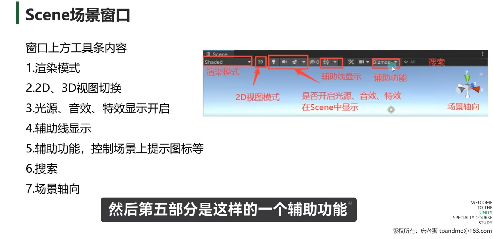
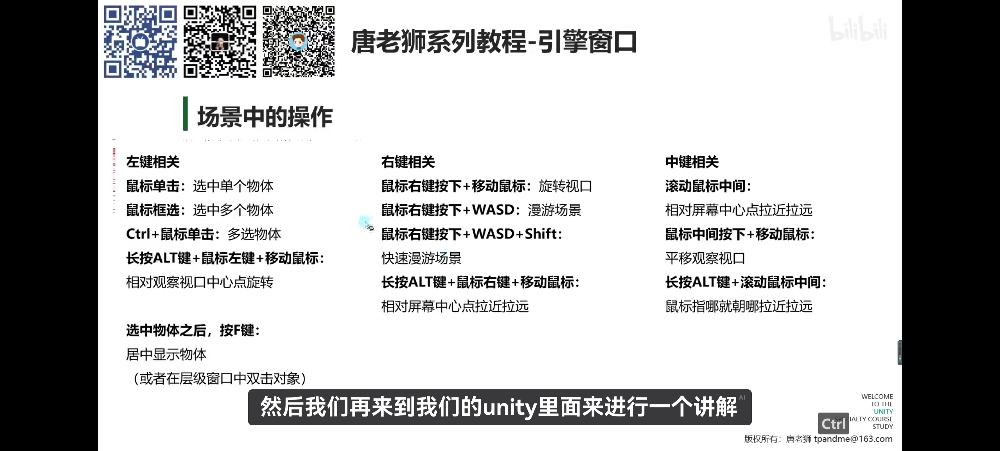
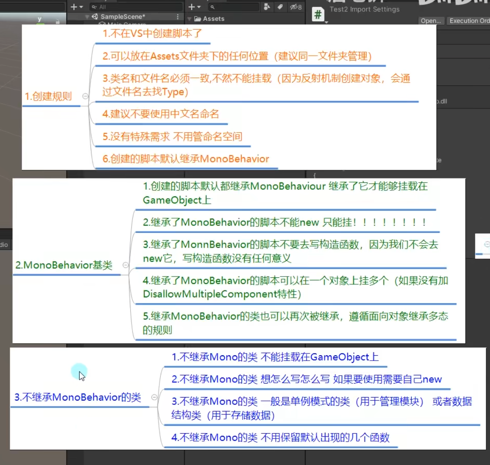

# 相关知识

仅仅列举我不会/不熟的内容

### 层级窗口快捷键
1. F2重命名
2. ctrl加D克隆一个
3. ctrl加z撤销
4. ctrl加y回溯撤销
### scene窗口

快捷键


### 默认脚本规则


### 一些快捷键

ctrl加shift 加f 用于摄像机

CTRL加alt加f翻译（意外之喜）

### 一些生命函数第18节

1. Awake  
出生时调用，一个对象调用一次
2. OnEnable  
每次激活时调用
3. Start  
帧更新前调用
4. FixUpdate  
固定时间更新，间隔可以设置（视频26分钟时）
5. Update  
帧更新
6. LateUpdate  
在Update后更新
7. OnDisable  
失活时调用
8. OnDestory  
被销毁时调用（销毁时会先调用一次失活）

### 窗口可编辑内容知识点（视频20节）

知识点一：`private`和`protect`的数据无法在面板上被看到  
知识点二：要让上面的信息暴露就加上`[Serializefield]`强制暴露
``` cs
[Serializefield]
private int num = 12;
```
知识点三：public可以直接暴露
知识点四：公共的也不让他暴露`[HIdeInInspector]`
``` cs
[HIdeInInspector]
public int num = 0 ;
```
知识点五：大部分数据类型都能显示  
``` cs
public int[] arr;
public List<int> list;
public GameObject gameObj;
//还有枚举
//不能显示的有
//字典，结构体，类
```
知识点六：除字典以外类和结构体都可以前面加上
`[System.Serializefield]`来访问  
知识点七一些辅助的特性  
1. [Header]  为数据添加个栏目
``` cs
[Header("基础属性")]
public int age;
public boll sex;
[Header("另一组属性")]
```
2. [Tooltip]悬浮说明,鼠标在miss上会出现文字内容
``` cs
[Tooltip("闪避")]
public int miss ;
```
3. [Space()] 让两个字段空一格
``` cs
[Space()]
public int age;
```
4. [Range(0,10)] 将数据限制在0到10内并且变为拖动形式
```cs
[Range(0,10)]
public float age;
```
5. 多行显示字符串，参数不写就是默认三行`[Multiline(5)]`
``` cs
[Multiline(5)]
public string tips;
//可以写五行字符串
```
6. 滚动条显示字符串`[TextArea(3,4)]`默认是超过3行显示滑动条
``` cs
[TextArea(3,4)] //显示3行超过4行显示滑动条
public string name;
```
7. 为变量设置成按钮，鼠标点击会显示方法
``` cs
[ContextMenuItem("重置钱"),"Test"] //第一个参数是方法名，第二个是函数名
public int money;

private void Test() //不一定要public，无返回值无参数
{
    money = 0 ;
}
```
8. 为脚本添加函数方法，可以在脚本的三个点处调用
``` cs
[ContextMenu("测试函数")]//你给他命的名
private void Test()
{
    Debug.log("测试");
    print("测试");
}
```
9. 已经挂上脚本的物体，修改脚本的默认值不会变！！！  
运行时修改值也不会变，可以复制后再黏贴
### mono中重要内容（视频22节）
