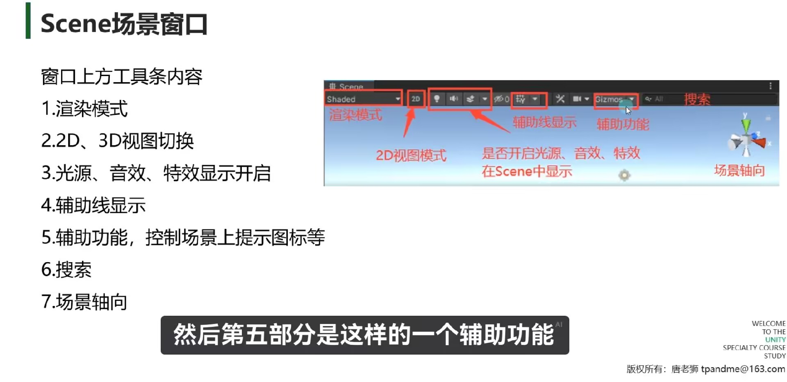
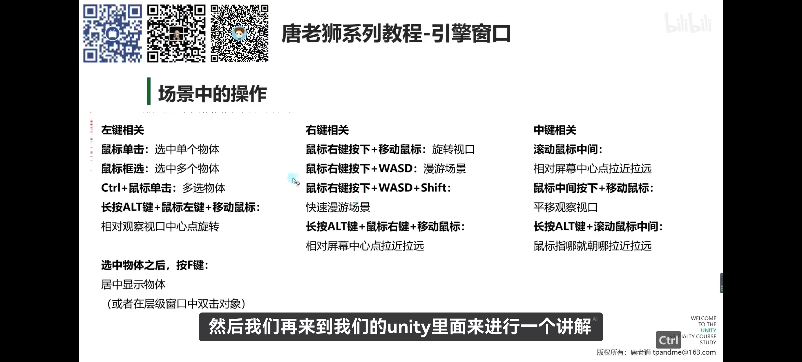
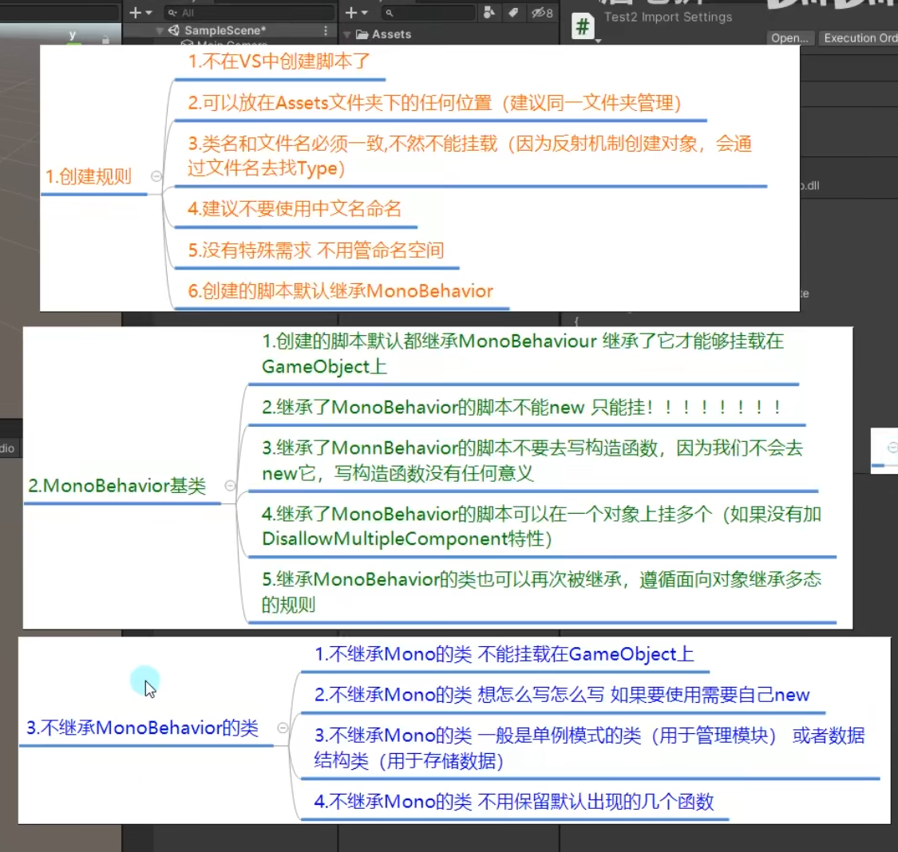

# 相关知识

仅仅列举我不会/不熟的内容

### 层级窗口快捷键
1. F2重命名
2. ctrl加D克隆一个
3. ctrl加z撤销
4. ctrl加y回溯撤销
### scene窗口

快捷键


### 默认脚本规则


### 一些快捷键

ctrl加shift 加f 用于摄像机

CTRL加alt加f翻译（意外之喜）

### 一些生命函数第18节

1. Awake  
出生时调用，一个对象调用一次
2. OnEnable  
每次激活时调用
3. Start  
帧更新前调用
4. FixUpdate  
固定时间更新，间隔可以设置（视频26分钟时）
5. Update  
帧更新
6. LateUpdate  
在Update后更新
7. OnDisable  
失活时调用
8. OnDestory  
被销毁时调用（销毁时会先调用一次失活）

### 窗口可编辑内容知识点（视频20节）

知识点一：`private`和`protect`的数据无法在面板上被看到  
知识点二：要让上面的信息暴露就加上`[Serializefield]`强制暴露
``` cs
[Serializefield]
private int num = 12;
```
知识点三：public可以直接暴露
知识点四：公共的也不让他暴露`[HIdeInInspector]`
``` cs
[HIdeInInspector]
public int num = 0 ;
```
知识点五：大部分数据类型都能显示  
``` cs
public int[] arr;
public List<int> list;
public GameObject gameObj;
//还有枚举
//不能显示的有
//字典，结构体，类
```
知识点六：除字典以外类和结构体都可以前面加上
`[System.Serializefield]`来访问  
知识点七一些辅助的特性  
1. [Header]  为数据添加个栏目
``` cs
[Header("基础属性")]
public int age;
public boll sex;
[Header("另一组属性")]
```
2. [Tooltip]悬浮说明,鼠标在miss上会出现文字内容
``` cs
[Tooltip("闪避")]
public int miss ;
```
3. [Space()] 让两个字段空一格
``` cs
[Space()]
public int age;
```
4. [Range(0,10)] 将数据限制在0到10内并且变为拖动形式
```cs
[Range(0,10)]
public float age;
```
5. 多行显示字符串，参数不写就是默认三行`[Multiline(5)]`
``` cs
[Multiline(5)]
public string tips;
//可以写五行字符串
```
6. 滚动条显示字符串`[TextArea(3,4)]`默认是超过3行显示滑动条
``` cs
[TextArea(3,4)] //显示3行超过4行显示滑动条
public string name;
```
7. 为变量设置成按钮，鼠标点击会显示方法
``` cs
[ContextMenuItem("重置钱"),"Test"] //第一个参数是方法名，第二个是函数名
public int money;

private void Test() //不一定要public，无返回值无参数
{
    money = 0 ;
}
```
8. 为脚本添加函数方法，可以在脚本的三个点处调用
``` cs
[ContextMenu("测试函数")]//你给他命的名
private void Test()
{
    Debug.log("测试");
    print("测试");
}
```
9. 已经挂上脚本的物体，修改脚本的默认值不会变！！！  
运行时修改值也不会变，可以复制后再黏贴
---
### mono中重要内容（视频22节）重点
#### GameObject 
``` cs
print(this.GameObject.name);//名字
print(this.transform.position);//位置
print(this.transform.rotation);//旋转
print(this.transform.lossyScale);//缩放
//脚本是否激活
this.enabled =false;
```

#### 获取组件
``` cs
//如果获取失败 就是没有对应的脚本 会默认返回空
攻击 t = this.GetComponent("攻击") as 攻击;
print(t);
//根据Type获取
t = this.GetComponent(typeof(攻击)) as 攻击;
print(t);
//根据泛型获取建议使用泛型获取因为不用二次转换
t = this.GetComponent<攻击>();
print(t);
//得到自己挂载的多个脚本
AudioClip[] array = this.GetComponents<AudioClip>();
print(array.Length);
List<攻击> list2 = new List<攻击>();
this.GetComponents<攻击>(list2);

print(list2.Count);
//获取子对象的脚本（也会同时获取自己是否挂了这个脚本）
//里面参数是是否失活的也要找，是gameobject失活不是脚本失活
t = this.GetComponentInChildren<攻击>(true);
List<攻击> listgj = new List<攻击>();
this.GetComponentsInChildren<攻击>(true,list2);
//父对象也一样，不过没有失活概念，也会包括自己
//父亲的父亲也是父对象
```

### GameObject重要组件(25-27)
#### 一些基本信息的获取
``` cs
print(gameObject.name);
gameObject.name = "新名字";
print(gameObject.activeSelf); //获取激活状态
print(gameObject.isStatic); //静态状态信息
print(gameObject.layer); //层级信息，int
print(gameObject.tag);//标签，string
print(gameObject.transform.position);
print(transform.rotation);//旋转
print(transform.lossyScale);//缩放
```

#### 一些基本方法
``` cs
//查找对象
    //1. 查找单个对象,无法找到失活对象,多个对象不确定找到的是谁
    //1.1 根据name查找，效率低一般不用
    GameObject obj2 = GameObject.Find("钱");
    //1.2 根据tag来查找
    obj2 = GameObject.FindWithTag("Player"); 
    obj2 = GameObject.FindGameObjectWithTag("Player");//与上面一个一样
    
    if(obj2 != null)
    {
        print(obj2.name);
    }
    else
    {
        print("没有找到");
    }
    //2. 查找多个对象，无法通过名字查找
    GameObject[] obj3 = GameObject.FindGameObjectsWithTag("Player");
    print("找到了" + obj3.Length + "个对象");
    //3. 找脚本来达到找该脚本身上的物体,效率最低，一般不用
    攻击特效 gj = GameObject.FindAnyObjectByType<攻击特效>();
    if (gj != null)
    {
        print(gj.gameObject.name);
    }
    //克隆对象，根据已经有的对象，来创建出新的
    //可以场上有的对象，或者预设体
    GameObject obj4 = GameObject.Instantiate(cloneOBJ);//可以用东西去接住他
    obj4.name = "钱克隆";
    //删除对象
    GameObject.Destroy(obj4); //删除
    GameObject.Destroy(this.gameObject , 5); //第二个参数为延迟秒数
    Destroy(this);//可以删除这个脚本

    //立即删除,上面会延迟一帧，避免卡顿
    GameObject.DestroyImmediate(obj4);

    //过场景不移除
    GameObject.DontDestroyOnLoad(this.gameObject);

    //创建空物体
    GameObject obj5 = new GameObject("我创建的空物体");//参数是名字
    GameObject obj6 = new GameObject("带脚本的空物体" , typeof(攻击) ,typeof(AudioClip));//后面几个参数是不定的，是自带的脚本

    //为已经有的物体加脚本

    obj6.AddComponent(typeof(攻击)); //可以用东西接住他
    攻击 gj2 = obj6.AddComponent(typeof(攻击)) as 攻击;
    攻击 gj3 = obj6.AddComponent<攻击>(); //一般用这个

    //对比标签,两种一样
    if (this.gameObject.CompareTag("Player"))
    {
        print("第一种比较标签");
    }
    if(this.gameObject.tag == "Player")
    {
        print("第二种比较tag");
    }

    //设置失活激活
    obj6.SetActive(false);
```

#### 不建议使用的方法
``` cs
    //查找自身带有的脚本中的方法，所有同名的都执行
    //不如直接获取脚本之后用
    this.gameObject.SendMessage("TestFun");
    this.gameObject.SendMessage("TestFun2" , 199);//如果是有参数的函数这样写
    
    gameObject.BroadcastMessage("函数名");//告诉子对象和自己
    gameObject.SendMessageUpwards("函数名");//告诉父对象和自己
```
#### 总结
1. 基本成员信息
2. 创建几何体
3. 查找场景中对象
4. 实例化对象
5. 删除对象
6. 过场景不移除
7. 对对象添加脚本
8. 设置激活失活状态
9. 得到脚本方法

### time相关知识29节

一般用于倍速和暂停
``` cs
void Update()
    {
        //时间缩放
        Time.timeScale = 0; //时间静止
        Time.timeScale = 2; //二倍数
        //帧间隔时间
        //1收到scale影响
        print(Time.deltaTime);//两帧之间时间

        //2不受到scale影响1
        print(Time.unscaledDeltaTime); 
        //选择，如果要不受暂停影响就用2，收到暂停影响就用1

        //游戏开始到现在的时间（单机游戏）
        print(Time.time);
        print(Time.unscaledTime);
        print(Time.frameCount); //一共跑了多少次循环
    }
    //物理帧时间
    private void FixedUpdate()
    {
        print(Time.fixedDeltaTime);
        print(Time.fixedUnscaledDeltaTime);
    }
```

### 位置相关知识点31课

``` cs
void Start()
    {
        Vector2 v = new Vector2();
        v.x = 10; //第一种
        v.y = 10;
        Vector2 v2 = new Vector2(10,10); //第二种，默认不写就是0，最常用
        v2 = v + v2 ; //运算符的重载 +-*/
        v2 = v2 / 1 ;

        //常用朝向世界的
        print(Vector3.zero); // 000
        print(Vector3.right); //100
        print(Vector3.left);//-100
        print(Vector3.forward);//001 
        print(Vector3.back);//00-1
        print(Vector3.up);//010
        print(Vector3.down);//0-10 

        //计算两个点之间的距离
        print(Vector3.Distance(v,v2));

        //位置信息
        //这个是世界坐标系的原点位置，不是父子关系，界面显示的是相对父对象的
        print(this.gameObject.transform.position) ;  //或者用this.transform.position来获取
        //这个是相对父对象的位置，如果没有父对象就是世界原点
        print(this.gameObject.transform.localPosition) ;  

        //修改
        //不能单独该位置只能整体改

        this.transform.localPosition = new Vector3 (10 ,10, 10);
        this.transform.localPosition = this.transform.localPosition + Vector3.up * 10 ; //没有没有前面加起来就是0，10 ， 0 因为是010乘以10
        //如果要只改一个部分
        this.transform.localPosition = new Vector3 (this.transform.localPosition.x , 10 ,this.transform.localPosition.z);
        //或者将位置信息取出来，再修改
        Vector3 vpos = this.transform.localPosition;
        vpos.y = 100 ;
        this.transform.localPosition = vpos; //别忘了放回去
        

        //朝向
        print(this.transform.forward); // 当前的的头顶朝向，旋转后
        print(this.transform.up);
        print(this.transform.right);
        //用于后续角色面朝向运动而不是依据世界朝向


    }

```